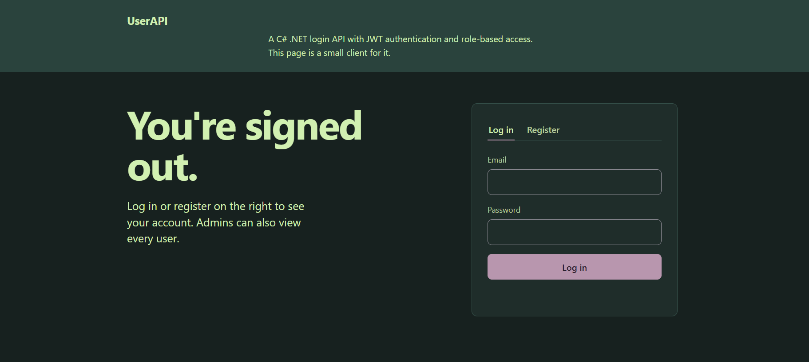
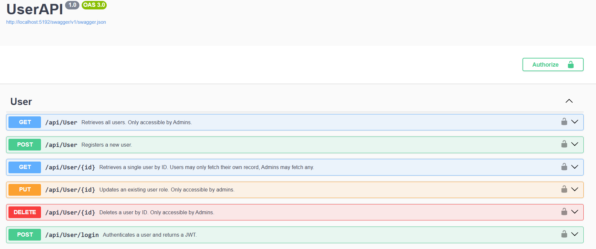

# UserAPI
A C# .NET REST API for user registration and login, using JWT authentication, and a PostgreSQL backend.

**Frontend Client:** https://userapi-i3ea.onrender.com/
*(Hosted on Render's free tier, so the first request can take up to a minute to wake up.)*

## Features
- JWT authentication
- PostgreSQL (hosted on Neon)
- Password hashing with BCrypt
- Automated tests with xUnit, run via GitHub Actions

## Endpoints
| Method | Route | Auth | Description |
|---|---|---|---|
| POST | `/api/User` | None | Registers a new user |
| POST | `/api/User/login` | None | Authenticates a user and returns a JWT |
| GET | `/api/User` | Admin | Retrieves all users |
| GET | `/api/User/{id}` | User (own record) or Admin | Retrieves a single user by ID. Users may only fetch their own record; Admins may fetch any |
| PUT | `/api/User/{id}` | Admin | Updates an existing user's role |
| DELETE | `/api/User/{id}` | Admin | Deletes a user by ID |

## Swagger Preview

